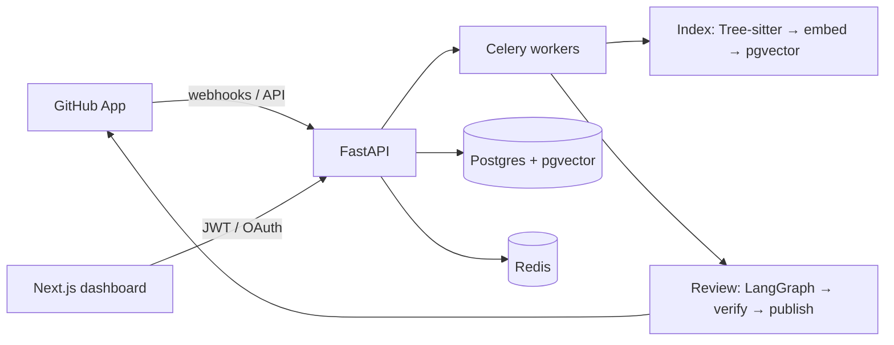

<p align="center">
  
</p>

<h1 align="center">Spider</h1>

<p align="center">
  <strong>AI code review that optimizes for real bugs — not more comments.</strong>
</p>

<p align="center">
  Index your repos. Review every PR with a multi-stage AI pipeline.<br/>
  Verify before you publish. Block merges when policy says so.
</p>

<p align="center">
  <a href="#quick-start"></a>
  <a href="#architecture"></a>
  <a href="https://github.com/arjun988/spider"></a>
  <a href="#license"></a>
</p>

<p align="center">
  <a href="#why-spider">Why</a> ·
  <a href="#features">Features</a> ·
  <a href="#how-a-review-works">How it works</a> ·
  <a href="#architecture">Architecture</a> ·
  <a href="#quick-start">Quick start</a> ·
  <a href="#configuration">Configuration</a> ·
  <a href="#security">Security</a>
</p>

---

## Why Spider

Most AI reviewers optimize for **comment count**. Spider optimizes for **precision**.

| Typical AI review | Spider |
| --- | --- |
| Floods the PR with style nits | Publishes only findings that clear severity, confidence, failure-scenario, and verification gates |
| Diff-only context | Tree-sitter symbols + embeddings retrieve the right code around the change |
| Soft suggestions | Check Runs + policy-as-code can **block merge** on secrets / critical vulns |
| Static quality forever | Feedback → verifier prompts → scorecard / eval closes the precision loop |

Spider is a full platform: GitHub App delivery, operator dashboard, SSO, budgets, webhook observability, and org policy packs — not a one-shot LLM prompt.

---

## Features

<table>
  <tr>
    <td width="50%" valign="top">

### Review pipeline
- LangGraph stages: analyze → retrieve → bug / security / test → **verify** → decide
- **Multi-LLM routing** — cheap triage model, stronger verify model
- Static analysis (secrets, SQL concat) under the same publish gates
- Optional Docker sandbox annotations
- Per-finding **decision traces** (“why published / why rejected”)

### GitHub delivery
- Inline review comments on the diff
- **Check Runs** with policy-aware pass / fail
- One-click **branch protection** helper (require Spider Review)
- Idempotent webhooks, DLQ replay, GitHub redelivery by delivery ID

### Policy-as-code
- Org packs: security policies, banned APIs, required tests
- Merge blocks: `block_on_secrets`, `block_on_critical`
- Packs injected into security & test agents

    </td>
    <td width="50%" valign="top">

### Code intelligence
- GitHub App clone / fetch
- Tree-sitter packs in the backend image (Python, JS/TS, Go, Rust, Java, C/C++, C#, Ruby, PHP, Kotlin)
- Chunk + embed + **pgvector** retrieval
- Incremental index, parallel embed batches, reuse unchanged blob vectors
- Per-repo rules: ignore paths, floors, languages, max findings

### Precision loop
- Helpful / FP / dismissed / fixed feedback
- Category + path FP rates → verifier prompts
- **Scorecard**: precision, FP rate, time-to-first-comment
- **Eval harness**: weekly precision / recall-proxy from labels

### Dashboard
- Overview, repos, PRs, review detail, usage & cost
- First-run wizard (detects missing App / key / tunnel)
- Webhook delivery metrics, audit log, CSV exports
- GitHub SSO + AuthGate (staging / prod force login)
- Light / dark theme, mobile drawer nav

    </td>
  </tr>
</table>

---

## How a review works

```text
  GitHub PR / comment
           │
           ▼
   Webhook (HMAC) ──► upsert PR ──► Celery review job
           │                              │
           │                    ┌─────────┴──────────┐
           │                    ▼                    ▼
           │              Check Run: in_progress   Index / context
           │                    │
           │                    ▼
           │         analyze → retrieve → hunt → verify → decide
           │                    │
           │                    ▼
           │         publish inline comments + Check Run conclusion
           │                    │
           ▼                    ▼
      Dashboard ◄──── feedback, scorecard, policy, audit
```

1. GitHub hits `/api/webhooks/github` (`pull_request` / `issue_comment`).
2. Spider enqueues a review job (deduped on commit SHA).
3. Pipeline analyzes the change, retrieves context, hunts issues, then verifies.
4. Decision gates apply org / repo thresholds, policy pack, and feedback signals.
5. Accepted findings become inline comments; Check Run completes **success** or **failure**.
6. Operators rate findings; scorecard + eval track quality over time.

Trigger anytime with `/review` or `/review-again` on the PR, or from the dashboard.

---

## Architecture



| Layer | Stack |
| --- | --- |
| Frontend | Next.js 15, TypeScript, Tailwind, TanStack Query, Recharts |
| Backend | FastAPI, SQLAlchemy, Alembic, Celery, LangGraph |
| Data | PostgreSQL + pgvector, Redis |
| AI | Gemini (default) or LiteLLM OpenAI-compatible proxy |
| Code intel | Tree-sitter, Git, ripgrep |

### Integrations

| System | Role |
| --- | --- |
| **GitHub App** | Installations, sync, diffs, webhooks, inline reviews, Check Runs |
| **Gemini / LiteLLM** | Generation + embeddings (BYOK) |
| **Postgres + pgvector** | App data + semantic retrieval |
| **Redis + Celery** | Indexing, reviews, webhook retry, reclaim |
| **Docker sandbox** | Optional isolated checks |
| **Sentry** | Optional error / trace reporting |
| **cloudflared / ngrok** | Local webhook reachability |

---

## Quick start

**Prerequisites:** Docker Compose, a [GitHub App](https://docs.github.com/en/apps), a Gemini API key (or LiteLLM), and optionally `cloudflared` for webhooks.

```bash
git clone https://github.com/arjun988/spider.git
cd spider
cp .env.example .env
```

Put your GitHub App private key at `secrets/github-app.pem`, then fill `.env` (see [Configuration](#configuration)).

```bash
docker compose up --build -d
docker compose exec backend alembic upgrade head
```

| Service | URL |
| --- | --- |
| Dashboard | http://localhost:3000 |
| API docs | http://localhost:8000/docs |
| Health | http://localhost:8000/api/health |
| LiteLLM UI | http://localhost:4000/ui |

Expose webhooks:

```bash
cloudflared tunnel --url http://localhost:8000
# → https://<tunnel>/api/webhooks/github
```

> Trycloudflare URLs change on every restart. Prefer a named tunnel for a stable webhook URL.

Then in the dashboard:

1. **Onboarding** — auto-detects missing App / OAuth / LLM / tunnel  
2. **Repositories** → Sync → Re-index → optional **Protect** (require Spider Check)  
3. **Settings** — LLM + triage/verify models + policy pack  
4. Open a PR (or comment `/review`)

```bash
# Manual review trigger
curl -X POST "http://localhost:8000/api/pull-requests/<pr-uuid>/review"
```

Optional sandbox image:

```bash
docker build -t spider-sandbox:latest -f backend/Dockerfile.sandbox backend
```

### Tests

```bash
docker compose exec backend pytest -q
```

Intentional bugs for e2e live in [`samples/buggy_repo/`](samples/buggy_repo/) (covered by `tests/test_e2e_buggy_repo.py`).

---

## Configuration

### Essential environment

| Variable | Purpose |
| --- | --- |
| `SECRET_KEY` / `ENCRYPTION_KEY` | App secrets / Fernet material |
| `GEMINI_API_KEY` | Direct Gemini (or set later in Settings) |
| `GITHUB_APP_ID` | GitHub App ID |
| `GITHUB_APP_CLIENT_ID` / `GITHUB_APP_CLIENT_SECRET` | OAuth SSO |
| `GITHUB_APP_WEBHOOK_SECRET` | Webhook HMAC |
| `GITHUB_APP_NAME` | Install URL helper |
| `FRONTEND_URL` | OAuth callback base (`http://localhost:3000`) |
| `AUTH_DISABLED_IN_DEV` | Local bypass when `APP_ENV=development` |
| `REQUIRE_AUTH` | Force SSO even in development |

Full template: [`.env.example`](.env.example).

### GitHub App

| | |
| --- | --- |
| **Permissions** | Contents (read), Pull requests (read/write), Checks (read/write), Metadata (read) |
| **Events** | `pull_request`, `installation`, `installation_repositories`, `issue_comment`, `check_run` |

### Auth modes

| Environment | Behavior |
| --- | --- |
| `development` + `AUTH_DISABLED_IN_DEV=true` | Local admin bypass (dashboard open) |
| `staging` / `production` | **Always** GitHub SSO — bypass ignored |
| Any + `REQUIRE_AUTH=true` | SSO required |

Sign in at `/login` when SSO is enabled.

---

## Project layout

```text
spider/
├── backend/app/
│   ├── api/routes/      # HTTP API
│   ├── github/          # App auth, webhooks, publisher, Check Runs
│   ├── indexing/        # clone → parse → embed → retrieve
│   ├── agents/          # LangGraph review + verifier
│   ├── verification/    # static analysis + sandbox
│   └── services/        # orchestration, policy, scorecard, LLM
├── frontend/app/        # dashboard (overview → webhooks)
├── samples/             # buggy fixtures for pipeline validation
├── litellm/             # optional proxy config
└── docker-compose.yml
```

---

## Security

- LLM keys encrypted at rest; API returns masked values only  
- GitHub App private key and installation tokens never leave the backend  
- Webhook HMAC (`X-Hub-Signature-256`) required in production  
- Sandbox: read-only, non-root, no network, CPU / memory / PID limits  
- Monthly budget gate before expensive review work  
- Role-gated APIs (`admin` / `member` / viewer); dashboard AuthGate when auth is required  
- Staging / production force GitHub SSO  

---

## Status

Spider is under active development (`v0.1.0`). APIs and schema may change as the precision loop and policy surface harden.

Roadmap themes: tighter labeled eval ground truth, richer org rule UX, and production hardening for multi-tenant installs.

---

## Contributing

Issues and PRs that improve **precision**, **operator clarity**, or **local setup** are especially welcome.

1. Fork and create a feature branch  
2. Keep changes focused; match existing style  
3. Run `docker compose exec backend pytest -q` before opening a PR  
4. Describe the *why* in the PR body  

---

## License

Private / internal use unless otherwise specified by the repository owner.

---

<p align="center">
  <sub>Built for teams who would rather ship fewer comments — and catch more real bugs.</sub>
</p>
